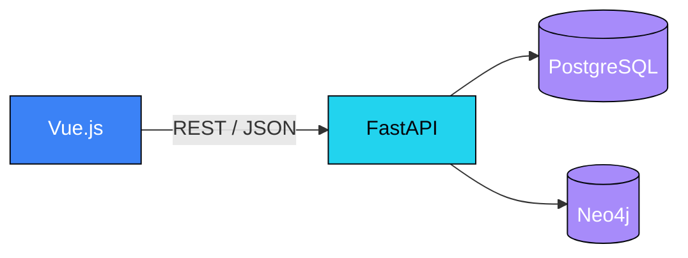

  

---

## Sobre mim

Construo servicos de backend e camadas de dados com **Python e FastAPI**, e as interfaces **Vue.js** que ficam por cima deles. Modelo dados relacionais em **PostgreSQL** e dados conectados em **Neo4j**.

- Interesse em arquitetura, modelagem de dados, grafos, automacao, APIs, IA aplicada e processamento de dados
- No laboratorio agora: **Bun, Elysia e TypeScript**
- Aberto a conversar sobre backend, dados e grafos

## Stack

## Projetos

<table>
  <tr>
    <td width="50%" valign="top">
      <a href="https://github.com/Thierryvinicius/twig-path-resolver"><b>twig-path-resolver</b></a> 
      <code>kotlin</code> · <code>plugin</code> · <code>twig</code>  
      Plugin que habilita Ctrl+Click em caminhos de views Twig em projetos Slim Framework, levando direto ao template.
    </td>
    <td width="50%" valign="top">
      <a href="https://github.com/Thierryvinicius/simulador_escalonamento_cpu"><b>simulador_escalonamento_cpu</b></a> 
      <code>python</code> · <code>sistemas operacionais</code>  
      Simulador de algoritmos de escalonamento de CPU a partir de uma fila de processos cadastrados.
    </td>
  </tr>
  <tr>
    <td width="50%" valign="top">
      <a href="https://github.com/Thierryvinicius/mini-twitter"><b>mini-twitter</b></a> 
      <code>javascript</code> · <code>web</code>  
      Projeto da disciplina de Topicos de Computacao: uma versao reduzida de rede social.
    </td>
    <td width="50%" valign="top">
      <a href="https://github.com/Thierryvinicius/analisador_lexico"><b>analisador_lexico</b></a> 
      <code>python</code> · <code>compiladores</code>  
      Analisador lexico em Python.
    </td>
  </tr>
</table>

<b>Ver mais repositorios</b>

 

| Repositorio | Linguagem |
| --- | --- |
| [mood_bot](https://github.com/Thierryvinicius/mood_bot) | Python |
| [server_chat](https://github.com/Thierryvinicius/server_chat) | Python |
| [abstract-factory](https://github.com/Thierryvinicius/abstract-factory) | PHP |
| [desafios_intelitrader](https://github.com/Thierryvinicius/desafios_intelitrader) | C++ |

## Estatisticas

## Contato

Quer trocar uma ideia sobre backend, dados ou grafos? Me chama no [LinkedIn](https://www.linkedin.com/in/thierry-vinicius/) ou por [e-mail](mailto:thierry.vinicius@outlook.com).

