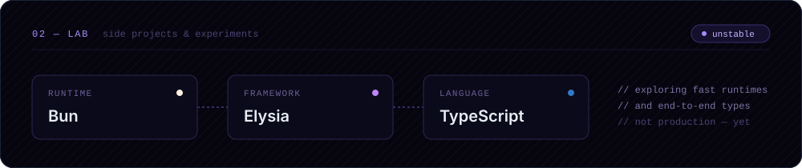

<!--
  Profile README — Thierry Vinicius
  Visual assets live in ./assets (hand-written SVGs, no external dependencies).
  Palette: #05070D bg · #3B82F6 electric blue · #22D3EE cyan · #A78BFA violet
-->

 
 

 
 

 
 

<!--
  03 — SELECTED WORK
  Placeholder: uncomment and fill with real public repositories.

 
 

<table>
  <tr>
    <td width="50%" valign="top">
      <a href="https://github.com/Thierryvinicius/REPO_NAME"><b>REPO_NAME</b></a> 
      <code>fastapi</code> · <code>postgresql</code>  
      One line about the problem it solves.
    </td>
    <td width="50%" valign="top">
      <a href="https://github.com/Thierryvinicius/REPO_NAME"><b>REPO_NAME</b></a> 
      <code>neo4j</code> · <code>vue</code>  
      One line about the problem it solves.
    </td>
  </tr>
</table>
-->

 
 

  <a href="https://github.com/Thierryvinicius"><code>github</code></a>
  &nbsp;·&nbsp;
  <a href="https://www.linkedin.com/in/thierry-vinicius/"><code>linkedin</code></a>
  &nbsp;·&nbsp;
  <a href="mailto:thierryv3011@gmail.com"><code>email</code></a>

  backend · data · full-stack

